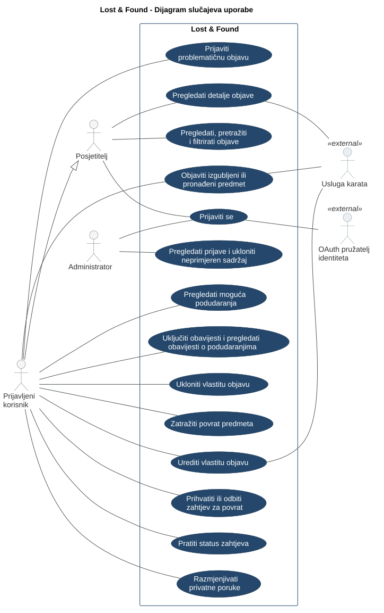

# 3. Use Cases

## 3.1 Use Case Diagram

**PlantUML source:** [Diagram source code](./puml/lost-and-found-UC.puml)

## 3.2 Use Case Descriptions

### UC-001: Browse, search, and filter posts

| Field | Description |
| --- | --- |
| Primary actor | Visitor or signed-in user. |
| Requirement IDs | F-001 |
| Preconditions | Sign-in is not required. |
| Main flow | The user opens the list of posts. They can enter a search term and filter posts by type, category, location, and time. The system displays matching results. |
| Alternative flows | If there are no matching posts, the system displays a message, and the user can change the criteria. |
| Result | Matching posts or a message indicating that there are no results are displayed. |

### UC-002: View post details

| Field | Description |
| --- | --- |
| Primary actor | Visitor or signed-in user. |
| Requirement IDs | F-002 |
| Preconditions | The post is publicly available. Sign-in is not required. |
| Main flow | The user selects a post. The system displays the post type, category, item title and description, date or approximate time of the event, status, location on a map, and a photograph if one has been added. The hidden item detail is not publicly displayed. |
| Alternative flows | If the post has been removed, the system informs the user that it is unavailable. If the map cannot be loaded, the remaining information is displayed with a message stating that the map is unavailable. |
| Result | The user has viewed the public information about the item. |

### UC-003: Sign in

| Field | Description |
| --- | --- |
| Primary actor | Visitor or administrator who is not signed in. |
| Secondary actor | External identity provider. |
| Requirement IDs | F-003 |
| Preconditions | The user has an account with the selected identity provider. |
| Main flow | 1. The user selects the sign-in option. 2. The system redirects them to an external identity provider to sign in using OAuth 2.0. 3. The user completes the sign-in process with the provider. 4. The system validates the provider's response and establishes a user session. |
| Alternative flows | If the user cancels or sign-in fails, they remain signed out and can use public functionality. |
| Result | The user is signed in and can access actions according to their assigned role. |

### UC-004: Publish a lost or found item post

| Field | Description |
| --- | --- |
| Primary actor | Signed-in user. |
| Secondary actor | External map service. |
| Requirement IDs | F-004, F-005 |
| Preconditions | The user is signed in. |
| Main flow | 1. The user opens the form for a new post. 2. They enter the post type, category, item title and description, and the date or approximate time of the event. 3. They specify the location using GPS or by selecting it on a map. 4. They optionally add a photograph and a hidden detail for ownership verification. 5. They confirm publication. 6. The system validates the information, saves the post, and displays confirmation. |
| Alternative flows | **GPS is unavailable or permission is denied:** The user selects the location on a map. **Information is incomplete or invalid:** The system requests corrections before saving. **Saving fails:** The system displays an error and does not confirm publication. |
| Result | The post is available for browsing, and the hidden detail is not publicly displayed. |

### UC-005: Edit own post

| Field | Description |
| --- | --- |
| Primary actor | Post author. |
| Secondary actor | External map service when changing the location. |
| Requirement IDs | F-005, F-006 |
| Preconditions | The user is signed in and is the author of an existing post. |
| Main flow | The user selects the option to edit their post, changes the information, and confirms saving. The system checks permissions and validates the information, then saves the changes. |
| Alternative flows | If the information is invalid, the system requests corrections. If the user is not the post author, the system rejects the edit. |
| Result | The post is updated, and the hidden detail remains excluded from public view. |

### UC-006: Remove own post

| Field | Description |
| --- | --- |
| Primary actor | Post author. |
| Requirement IDs | F-007 |
| Preconditions | The user is signed in and is the author of an existing post. |
| Main flow | The user selects the option to remove their post and confirms the decision. The system checks permissions and removes the post from public view. |
| Alternative flows | If the user cancels, the post remains available. If they are not the post author, the system rejects the removal. |
| Result | The post is no longer publicly available. |

### UC-007: Request the return of an item

| Field | Description |
| --- | --- |
| Primary actor | Signed-in user who believes they own the item. |
| Requirement IDs | F-008 |
| Preconditions | The user is signed in, and the found item post is available for submitting a request. |
| Main flow | 1. The user opens the post and selects the option to submit a return request. 2. They provide information supporting their ownership claim, including item characteristics that are not publicly displayed. 3. They submit the request. 4. The system saves the request and makes it available to the post author. 5. The user is shown confirmation and a request status indicating that a decision is pending. |
| Alternative flows | **Required information is missing:** The system requests the missing information. **The post is no longer available for a return request:** The system does not save the request and informs the user. **Submission fails:** The system does not confirm submission and displays an error. |
| Result | The request has been sent to the post author. Its contents are not publicly available. |

### UC-008: Accept or reject a return request

| Field | Description |
| --- | --- |
| Primary actor | Post author. |
| Requirement IDs | F-009 |
| Preconditions | The author is signed in, and a request for their post is awaiting a decision. |
| Main flow | 1. The author opens the return request. 2. They review the provided information and compare it with the item's characteristics, including the hidden detail if one has been recorded. 3. They assess the request and accept or reject it. 4. The system saves the decision and displays the updated status to the author and the requester. |
| Alternative flows | **Insufficient information:** The author can request additional information through a private message and make a decision later. **Unauthorized processing attempt:** The system rejects the change if the user is not the post author. **Saving fails:** The system does not confirm the status change and displays an error. |
| Result | The request is accepted or rejected. Acceptance does not mean that the physical handover of the item has already been completed. |

### UC-009: Track request status

| Field | Description |
| --- | --- |
| Primary actor | Requester or author of the associated post. |
| Requirement IDs | F-010 |
| Preconditions | The user is signed in. |
| Main flow | The user opens the overview of sent or received requests. The system displays requests in which the user participates and their current statuses. |
| Alternative flows | If there are no requests, the system displays an appropriate message. Access to other users' requests is not permitted. |
| Result | The user is informed about the status of their sent or received requests. |

### UC-010: Exchange private messages

| Field | Description |
| --- | --- |
| Primary actor | Requester or author of the associated post. |
| Requirement IDs | F-011 |
| Preconditions | The user is signed in, and a return request has already been submitted. Acceptance of the request is not required for communication. |
| Main flow | The user opens the conversation associated with the request, reviews messages, and sends a new message. The system saves it and makes it available to the other participant to help verify ownership or arrange collection. |
| Alternative flows | The system denies access to a user who is not a participant in the conversation. If sending fails, the message is not shown as successfully sent. |
| Result | Participants can exchange information privately without publicly sharing contact details. |

### UC-011: View possible matches

| Field | Description |
| --- | --- |
| Primary actor | Signed-in user. |
| Requirement IDs | F-012 |
| Preconditions | The user is signed in and has a post for which matches are being sought. |
| Main flow | The user opens the possible matches for their post. The system displays suggestions based on category, description, time, and location. The user can open the details of a suggested post. |
| Alternative flows | If there are no possible matches, the system displays an appropriate message. |
| Result | The user has reviewed the suggestions. A match does not confirm ownership. |

### UC-012: Enable notifications and view match notifications

| Field | Description |
| --- | --- |
| Primary actor | Signed-in user who has published a lost item post. |
| Requirement IDs | F-013 |
| Preconditions | The user is signed in and has a lost item post. |
| Main flow | The user enables notifications about possible matches. When a new post matches their post according to the matching criteria, the system displays an in-app notification. The user opens the notification and the associated post. |
| Alternative flows | If notifications are not enabled or there are no new matches, the system does not create a new notification. If the associated post is no longer available, the system informs the user. |
| Result | Notifications about new possible matches are available to the user who has enabled them. |

### UC-013: Report a problematic post

| Field | Description |
| --- | --- |
| Primary actor | Signed-in user. |
| Requirement IDs | F-014 |
| Preconditions | The user is signed in. The post is available. |
| Main flow | The user selects the option to report a post, provides a reason, and submits the report. The system saves it and makes it available to the administrator. |
| Alternative flows | If no reason is provided, the system requests one. If the post has been removed in the meantime, the system informs the user. |
| Result | The report is available to the administrator. Submitting the report does not automatically remove the post. |

### UC-014: Review reports and remove inappropriate content

| Field | Description |
| --- | --- |
| Primary actor | Administrator. |
| Requirement IDs | F-015 |
| Preconditions | The administrator is signed in and has administrator privileges. |
| Main flow | The administrator opens a report and reviews the reason and the associated post. If they determine that the content is inappropriate, they select and confirm removal. The system removes the post from public view. |
| Alternative flows | If the report is unjustified, the post remains available. If there are no reports or the post has already been removed, the system displays an appropriate message. The system denies access to users without administrator privileges. |
| Result | The report has been reviewed, and inappropriate content has been removed if the administrator determined that removal was justified. |

---

## 3.3 Use Case Consistency Check

The following questions help the team check consistency between the use cases, requirements, and application.

| Check | Question for the team |
| --- | --- |
| Requirement links | Does each use case from UC-001 to UC-014 reference the appropriate requirement IDs from the second document? |
| Public access | Can visitors browse, search, and filter posts and view their details without signing in, as described in UC-001 and UC-002? |
| User permissions | Do UC-005 and UC-006 allow only the post author to edit and remove the post, and does UC-008 allow only the author of the associated post to process a request? |
| Ownership verification | Does the hidden detail remain private in UC-002, and is it used to assess ownership in the process described in UC-007 and UC-008? |
| Private communication | Is the conversation in UC-010 available only to the participants after a request has been submitted, without requiring prior acceptance? |
| Reporting and moderation | Is reporting posts in UC-013 available only to signed-in users, and is moderation in UC-014 available only to the administrator? |
| Alternative flows | Does UC-004 allow manual location selection when GPS is unavailable and prevent incomplete information from being saved? |
| Application verification | Can the team demonstrate the described main and alternative flows, or are they still marked as planned behavior? |
