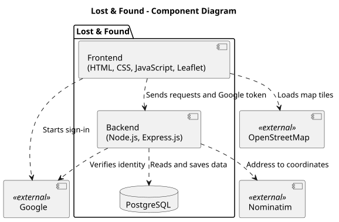
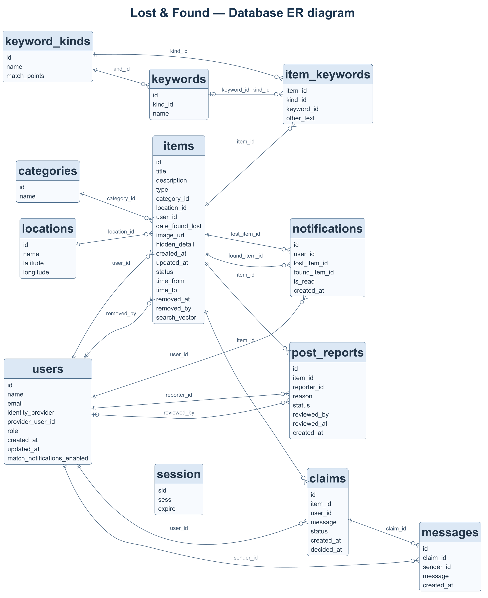
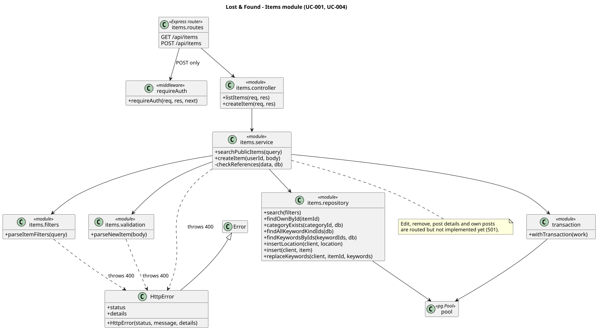
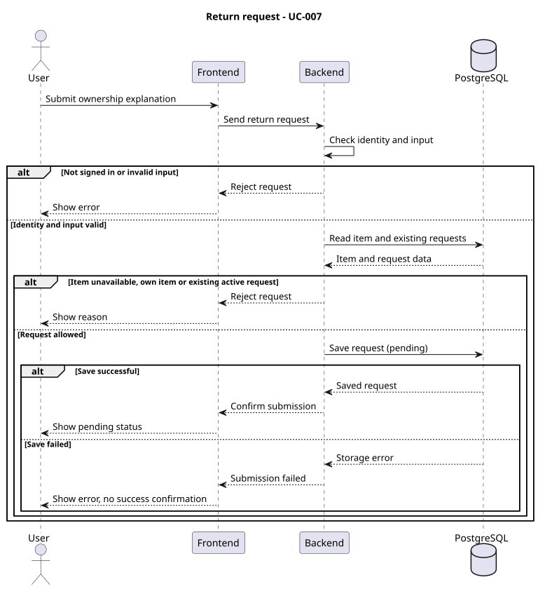
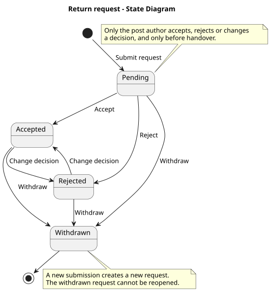

# 4. Architecture and Design

Lost & Found has a web interface, a Node.js backend, and a PostgreSQL database. It uses Google for sign-in, Leaflet and OpenStreetMap for maps, and Nominatim to convert addresses into coordinates. This chapter describes the system’s design, its main components, the data it stores, and how it works.

| View | Main question |
| --- | --- |
| Solution strategy | Which architectural choices were made, and why? |
| Building blocks | What are the principal parts, their responsibilities, and their external connections? |
| Data and class design | What information is stored, and how is a representative part of the code structured? |
| Runtime behavior | How do parts collaborate, and how does a meaningful object change state? |
| Architectural decisions | Why was a consequential option chosen over alternatives? |
| Crosscutting concepts and risks | Which shared mechanisms and important compromises affect the design? |

## 4.1 Solution Strategy

Lost & Found has a web interface built with HTML, CSS, and JavaScript, a single Node.js backend using Express.js, and a PostgreSQL database. Vite is used for frontend development and production builds. The following describes the selected design and does not confirm that all functionality has already been implemented.

| Decision | Alternative considered | Project-specific rationale and trade-off |
| --- | --- | --- |
| A single Node.js backend with Express.js | Java (Spring Boot) | We are familiar with these technologies, and we use JavaScript on both the frontend and the backend. A single backend simplifies development, but its failure affects most functionality. |
| PostgreSQL relational database | MongoDB | We are familiar with PostgreSQL, and it suits related data such as users, posts, and requests. Structural changes require adjustments to the database. |
| Google sign-in | Microsoft (Entra ID) | The user uses an existing account, and the application does not manage their Google password. Sign-in depends on an external service. |
| Leaflet + OpenStreetMap | MapLibre GL + MapTiler | Leaflet displays the OpenStreetMap base map. Map display depends on the availability of the map service. |
| Nominatim | MapTiler Geocoding | Nominatim converts addresses into coordinates. Address search depends on the availability of the geocoding service. |

## 4.2 Building Blocks and UML Component Diagram

The frontend displays data and collects user input. The backend validates data and permissions and communicates with the database. Google, OpenStreetMap, and Nominatim are outside the boundary of our application, while Leaflet is a library within the frontend.

**Component diagram:**

**PlantUML source:** [Diagram source](./puml/component-diagram.puml)

| Component | Responsibility | Reason for this boundary |
| --- | --- | --- |
| Frontend | Displays posts, the map, forms, messages, and notifications. | Separates the user interface from data processing. |
| Backend | Handles requests, checks permissions, calculates matches, and accesses external services. | Application rules are checked on the server. |
| PostgreSQL database | Stores users, posts, requests, messages, and other related data. | Provides persistent storage and maintains relationships between data. |

Vite is used for local frontend development and production builds. The frontend code is organized into pages, reusable components, API access functions, and session state.

The Express backend is organized by functionality, including authentication, items, claims, messages, notifications, and moderation. Within these modules, routes connect API endpoints to controllers, controllers handle HTTP requests and responses, services contain application rules, and repositories access PostgreSQL. Shared middleware handles authentication, administrator access, and errors.

This structure is already present in the repository, but several modules still contain placeholder implementations. Their presence does not mean that all associated functionality is complete.

The frontend receives Google's token and sends it to the backend for verification. The request to convert an address into coordinates also passes through the backend, which calls Nominatim. The frontend loads the OpenStreetMap base map through Leaflet. Matching is based on keyword scoring; the final threshold has not yet been agreed upon.

## 4.3 Data and Detailed Design

### 4.3.1 ER Diagram and Data Model

Lost & Found stores its data in PostgreSQL. The current schema contains twelve tables and defines their primary keys, foreign keys, uniqueness rules, and validation constraints.

**ER diagram:**

**Diagram source:** [pgAdmin ERD source](./assets/erd/lostAndFoundERD.pgerd)

**Implementation:** [PostgreSQL schema](../database/schema.sql)

The diagram represents the stored data and relationships defined in the SQL schema. The main entities are users, item posts, return requests, and messages.

Each item post belongs to one author, one category, and one location. A user can publish multiple posts. The `type` attribute distinguishes lost and found posts. 
The `pending` status means that the case is unresolved: for a lost item, the author is still looking for it; for a found item, its return has not yet been completed. The `handed_over` status indicates that the item has been handed over.

A post can receive multiple return requests from different users. Each request belongs to one post and one requester. Messages belong to a request, which provides the context for the private conversation between the requester and the post author. Each message also references its sender. The backend must verify that the sender is a participant in that conversation.

The remaining tables support the following functions:

- `keyword_kinds`, `keywords`, and `item_keywords` store keyword types, predefined values, and the values associated with a post. A post can have one value per keyword type: either a predefined keyword or custom text entered under “Other”.
- `post_reports` stores reports of problematic posts, the users who submitted them, and moderation information. The reviewer and review time can remain empty until the report is reviewed.
- `notifications` links a recipient to a possible lost–found item match. A uniqueness constraint prevents duplicate notifications for the same recipient and pair of posts.
- `session` stores backend session data and expiration times. It has no foreign-key relationship to `users` in the current schema.

Return requests use the statuses `pending`, `accepted`, `rejected`, and `withdrawn`. Unique indexes allow at most one pending or accepted request per user and item, and at most one accepted request per item. Accepting a request does not automatically mark the item as handed over.

Posts can be removed from public view while their records remain stored. The `removed_at` and `removed_by` attributes record removal information. The `items_public` view excludes removed posts and the hidden item detail; the backend must use appropriate queries and authorization checks when serving public data.

The schema also defines automatic `updated_at` triggers for users and posts, a generated text-search field, and the `item_match_scores` view. This view calculates keyword-based matching scores: each keyword shared by a lost and a found post adds the points of its keyword kind. Category, location, and time are not compared, as agreed in [Section 2.5](./2-requirements.md#25-significant-requirement-changes). These database mechanisms are defined in the SQL schema rather than represented as separate entities in the ER diagram.

### 4.3.2 Representative UML Class Diagram

The diagram shows the backend items module, which implements browsing posts (UC-001) and publishing a post (UC-004). The backend is written in JavaScript modules rather than classes, so each module is shown as a class with the `<<module>>` stereotype and its exported functions as operations. `HttpError` is the only actual class.

**Class diagram:**

**PlantUML source:** [Class diagram source](./puml/class-diagram.puml)

| Module or class | Responsibility |
| --- | --- |
| `items.routes` | Connects `GET /api/items` and `POST /api/items` to the controller. Publishing passes through `requireAuth`, which rejects requests without a signed-in user. |
| `items.controller` | Translates HTTP requests into service calls and returns JSON responses. It contains no application rules. |
| `items.service` | Contains the application rules. It parses search filters, validates a new post, checks that the category and keywords exist and that every keyword kind has exactly one value, and saves the post inside one transaction. |
| `items.filters`, `items.validation` | Check query parameters and the new-post body. Every invalid field is collected and reported in one `HttpError` with status 400. |
| `items.repository` | Contains the SQL queries. Public queries use the `items_public` view, so hidden details and removed posts are never returned. |
| `transaction` | Runs the location, item, and keyword inserts in one database transaction and rolls back if any step fails (NF-005). |
| `HttpError` | Extends `Error` with an HTTP status and optional details; the shared error handler turns it into a JSON response. |

Editing, removing, viewing a single post, and listing the user's own posts are already routed in the same module but are not implemented yet; they answer with status 501.

## 4.4 Runtime Behavior
The following diagrams describe the planned return-request workflow.
The database already defines request statuses and uniqueness constraints, but the backend operations for submitting and processing requests and exchanging messages are not yet implemented. 
The diagrams describe the intended behavior and must be checked against the implementation as development continues.

### 4.4.1 Representative UML Sequence Diagram

**Scenario:** Submitting a return request — UC-007.

The user enters information supporting their ownership claim and submits the request. The backend first checks sign-in and the submitted data, then the item's availability and existing requests. It does not allow a request for the user's own item or an additional request while a previous request for the same item is pending or accepted. A new request can be submitted after rejection or withdrawal.

A valid request is saved with the status `pending`. Confirmation is displayed only after successful saving. Invalid data, an unavailable item, or a storage failure produces an error message without confirming success. After submission, the post author and the requester can exchange private messages.

**Sequence diagram:**

**PlantUML source:** [Sequence diagram source](./puml/return-request-sequence.puml)

### 4.4.2 Representative UML State Diagram

**State owner and reason for choosing it:** A return request. Its status indicates whether it is awaiting a decision, accepted, rejected, or withdrawn, making it important for tracking the return process.

| State | Meaning |
| --- | --- |
| `pending` | The request is awaiting the post author's decision. |
| `accepted` | The author has accepted the request. |
| `rejected` | The author has rejected the request. |
| `withdrawn` | The requester has permanently withdrawn the request. |

The author can accept or reject a request and change the decision before the item has been handed over. The requester can withdraw a request, including an accepted or rejected one. A withdrawn request is not reopened; a new one is submitted if needed. Accepting a request is not the physical handover; the post separately has the status `pending` or `handed_over`.

**State diagram:**

**PlantUML source:** [State diagram source](./puml/return-request-state.puml)

The statuses and the restriction of one active request are defined in the [database schema](../database/schema.sql). Permission checks and allowed transitions must be implemented in the backend; the schema alone does not enforce all the described transitions.

## 4.5 Architecture Decision Records

The following records summarize the architectural choices described in Section 4.1 and reflected in the repository. The original decision dates were not recorded. The status refers to the selected technology or structure, not completion of every application feature.

| ID | Decision | Alternative recorded in Section 4.1 | Rationale and trade-off | Status and evidence |
| --- | --- | --- | --- | --- |
| ADR-01 | Use one Node.js backend with Express.js. | Java with Spring Boot. | The team is familiar with JavaScript and uses it on both the frontend and backend. A single backend simplifies development and integration, but a backend failure affects most application operations. | In use: [Express application](../backend/src/app.js) and [backend dependencies](../backend/package.json). |
| ADR-02 | Use PostgreSQL for persistent storage. | MongoDB. | Users, posts, requests and messages have relationships that can be represented using foreign keys and constraints. Schema changes have to be coordinated with the backend and existing data. | In use: [database schema](../database/schema.sql). |
| ADR-03 | Use Google account sign-in. | Microsoft Entra ID. | Users sign in with an existing account, and the application does not store their Google passwords. Sign-in depends on Google's availability and correct client configuration. | In use: [authentication service](../backend/src/modules/auth/auth.service.js). |
| ADR-04 | Use Leaflet with OpenStreetMap tiles. | MapLibre GL with MapTiler. | Leaflet provides the map interface used for location selection. Map display depends on an external tile service and requires attribution. | In use: [map component](../frontend/src/components/mapView.js). |
| ADR-05 | Use Nominatim for address lookup. | MapTiler Geocoding. | Address lookup is performed through the backend, which handles validation, caching and request scheduling. The external service may be unavailable or busy, so manual map selection remains necessary. | In use: [geocoding service](../backend/src/modules/geocoding/geocoding.service.js). |

## 4.6 Crosscutting Concepts

The following mechanisms are shared across the application functions.

| Concern | Mechanism and current scope | Implementation reference |
| --- | --- | --- |
| Authentication | The backend verifies Google ID tokens and establishes a server-side session. Protected routes use middleware to reject requests without a signed-in user. | [Authentication service](../backend/src/modules/auth/auth.service.js), [authentication middleware](../backend/src/middleware/requireAuth.js). |
| Authorization | Administrator middleware checks the session role. Authorship and conversation-participant checks must also be implemented in the relevant operations; authentication alone does not establish permission to access another user's data. | [Administrator middleware](../backend/src/middleware/requireAdmin.js). |
| Session handling | Sessions are stored in PostgreSQL. The session cookie is HTTP-only, uses `SameSite=Lax`, and is marked secure in production. | [Session configuration](../backend/src/config/session.js). |
| Input validation | Post validation checks required fields, text lengths, dates, coordinates and keyword input. The service separately checks whether categories and keywords exist and belong to the correct keyword kinds. | [Post validation](../backend/src/modules/items/items.validation.js), [item service](../backend/src/modules/items/items.service.js). |
| Transactional writes | Creating a post saves its location, item record and keywords within one transaction. A failure before commit causes the transaction helper to attempt rollback rather than commit partial changes. | [Transaction helper](../backend/src/db/transaction.js), [item service](../backend/src/modules/items/items.service.js). |
| Error handling | `HttpError` carries an HTTP status and optional details. Shared middleware produces JSON error responses and hides internal server-error messages in production. Frontend handling must be verified for each user flow. | [HttpError](../backend/src/utils/HttpError.js), [error handler](../backend/src/middleware/errorHandler.js). |
| Public and private data | Public listing queries exclude hidden item details and removed posts. Other operations must apply their own access checks before returning private information. | [Database views](../database/schema.sql), [item repository](../backend/src/modules/items/items.repository.js). |
| External address lookup | The geocoding service validates input, caches results, spaces outgoing requests and applies timeouts. It reports unavailability instead of treating failed address searches as successful results. | [Geocoding service](../backend/src/modules/geocoding/geocoding.service.js). |
| Backend startup and reconnection | During slow requests, the frontend displays a connection notice. For selected connection failures, it attempts to wake the backend and retries the request. If necessary, a read request triggers navigation to the backend wake page, which redirects the user back to the application. Retries are limited; successful reconnection is not guaranteed. | [Frontend API client](../frontend/src/api/client.js), [backend wake route](../backend/src/app.js). |

## 4.7 Architectural Risks and Technical Debt

The following risks and limitations describe the current architecture. Proposed follow-up work is distinguished from mechanisms already present in the code.

### Technical Risks and Compromises

| Risk or compromise | Consequence | Current treatment and follow-up |
| --- | --- | --- |
| Dependence on Google sign-in | New sign-ins may fail if Google is unavailable or the client configuration is incorrect. | The sign-in page displays an error and allows users to continue public browsing. Real sign-in and failure scenarios require browser verification. |
| Dependence on external map tiles and geocoding | The map or address search may be unavailable independently of the application database. | The map component supports tile-error callbacks. The geocoding service uses caching, request scheduling and timeouts, and its error message directs users to manual map selection when address lookup fails. Map-tile failure and GPS-denial behavior still require browser checks. |
| A shared backend and database serve the main workflows | Failure of either can interrupt several application functions. | The repository defines a single backend service and database in its deployment configuration. The project does not claim automatic failover or a verified recovery procedure. |
| Database changes must remain compatible with application code and existing data | A schema update may fail against existing records or leave the backend expecting a different structure. | Use the versioned schema and database setup procedure. Verify changes against a test database containing representative existing data before applying them to the shared environment. |
| Post retrieval occurs after the creation transaction commits | A post may be saved successfully even if retrieving it for the response subsequently fails. A retry could create a duplicate post. | This remains an open consistency risk. Add a test for this failure point and consider returning the required data from within the transaction or introducing retry-safe creation. |

### Domain Risks

| Risk | Consequence | Current treatment and follow-up |
| --- | --- | --- |
| A requester may incorrectly claim ownership | An item could be handed to the wrong person. | The design uses hidden item details and private messages to help the finder assess ownership before handover. Ownership cannot be guaranteed. |
| Different items may share the same keywords | Matching may suggest an unrelated item or miss the correct one. | Keyword scores provide suggestions. Users still need to compare item details and verify ownership before handover. Test matching with similar items and incomplete descriptions. |
| Users may publish false or inappropriate posts | Other users may waste time or receive misleading information. | The planned reporting and moderation functions allow signed-in users to report posts and administrators to remove inappropriate content. |
| Users may reveal personal information in a description or photograph | Contact details or information on an ID card could become publicly visible. | Hidden item details are excluded from public responses. Add a reminder to avoid publishing personal information and verify that public views do not expose hidden details. |
