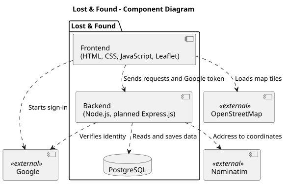
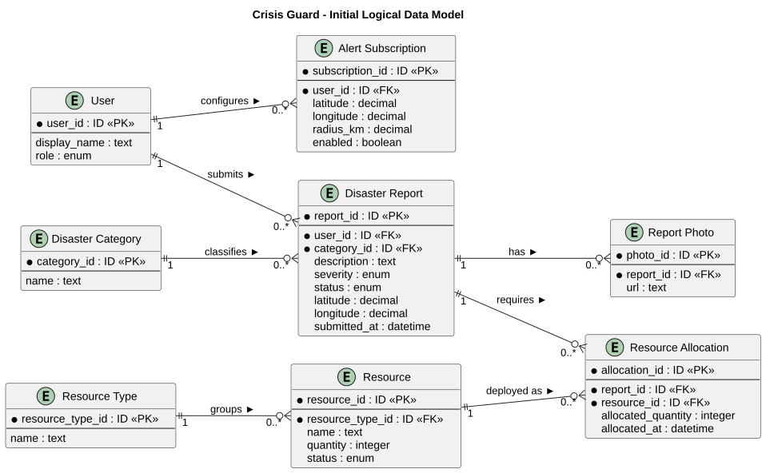
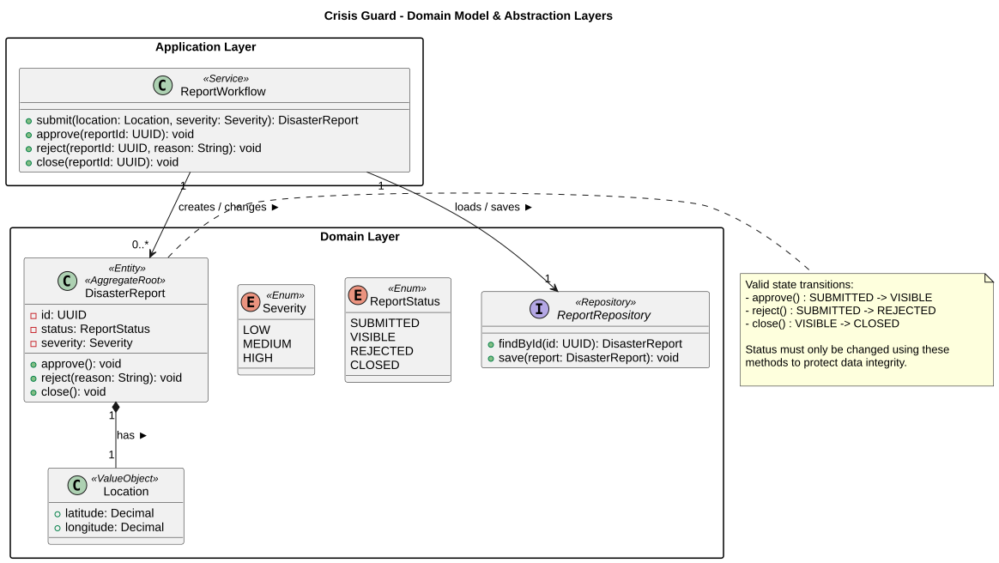
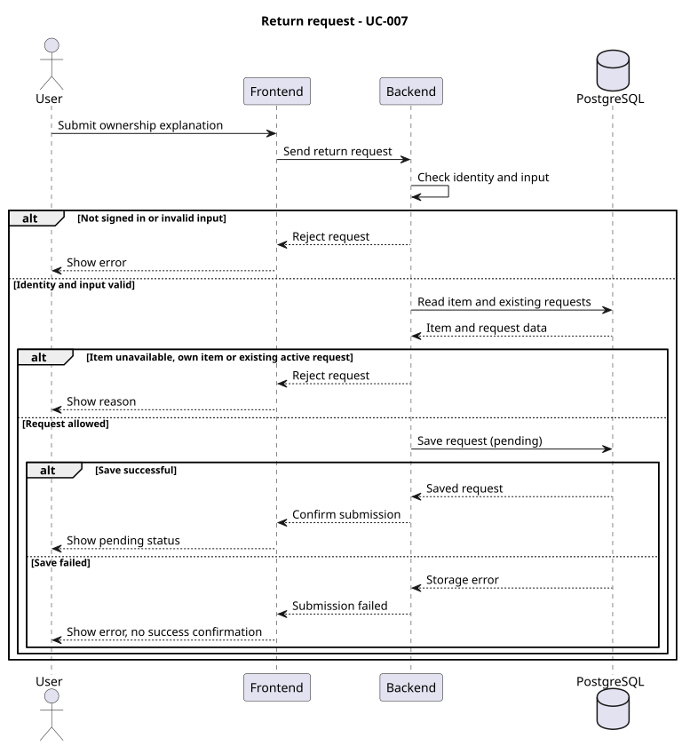
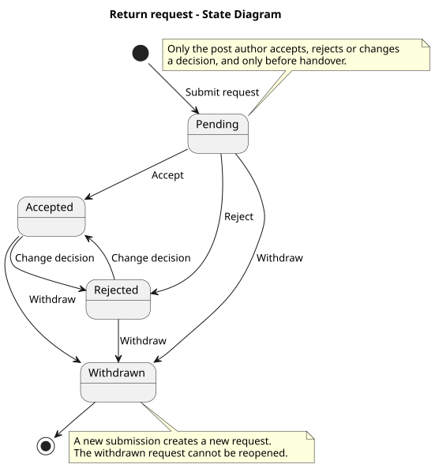

# 4. Architecture and Design

Lost & Found sastoji se od web-sučelja, Node.js backenda i PostgreSQL baze podataka. Za prijavu koristi Google, za karte Leaflet i OpenStreetMap, a za pretvaranje adresa u koordinate Nominatim. Ovo poglavlje opisuje odabrani dizajn, glavne komponente, podatke i ponašanje sustava.

| View | Main question |
| --- | --- |
| Solution strategy | Which architectural choices were made, and why? |
| Building blocks | What are the principal parts, their responsibilities, and their external connections? |
| Data and class design | What information is stored, and how is a representative part of the code structured? |
| Runtime behavior | How do parts collaborate, and how does a meaningful object change state? |
| Architectural decisions | Why was a consequential option chosen over alternatives? |
| Crosscutting concepts and risks | Which shared mechanisms and important compromises affect the design? |

## 4.1 Solution Strategy

Lost & Found has a web interface built with HTML, CSS, and JavaScript, a single Node.js backend, and a PostgreSQL database. We plan to add Express.js for request handling. The following describes the selected design and does not confirm that all functionality has already been implemented.

| Decision | Alternative considered | Project-specific rationale and trade-off |
| --- | --- | --- |
| A single Node.js backend with Express.js planned | Other options have not been documented. | We are familiar with these technologies, and we use JavaScript on both the frontend and the backend. A single backend simplifies development, but its failure affects most functionality. |
| PostgreSQL relational database | Other options have not been documented. | We are familiar with PostgreSQL, and it suits related data such as users, posts, and requests. Structural changes require adjustments to the database. |
| Google sign-in | Other options have not been documented. | The user uses an existing account, and the application does not manage their Google password. Sign-in depends on an external service. |
| Leaflet, OpenStreetMap, and Nominatim | Other options have not been documented. | Leaflet displays the OpenStreetMap map, and Nominatim converts addresses into coordinates. The map and address search depend on the availability of these services. |

## 4.2 Building Blocks and UML Component Diagram

The frontend displays data and collects user input. The backend validates data and permissions and communicates with the database. Google, OpenStreetMap, and Nominatim are outside the boundary of our application, while Leaflet is a library within the frontend.

**Component diagram:**

**PlantUML source:** [Diagram source](./puml/component-diagram.puml)

| Component | Responsibility | Reason for this boundary |
| --- | --- | --- |
| Frontend | Displays posts, the map, forms, messages, and notifications. | Separates the user interface from data processing. |
| Backend | Handles requests, checks permissions, calculates matches, and accesses external services. | Application rules are checked on the server. |
| PostgreSQL database | Stores users, posts, requests, messages, and other related data. | Provides persistent storage and maintains relationships between data. |

The frontend receives Google's token and sends it to the backend for verification. The request to convert an address into coordinates also passes through the backend, which calls Nominatim. The frontend loads the OpenStreetMap base map through Leaflet. Matching is based on keyword scoring; the final threshold has not yet been agreed upon.

## 4.3 Data and Detailed Design

**Objective:** Explain the important information the application stores and one representative area of class-level design. The data model and UML class diagram answer different questions; one does not replace the other.

### 4.3.1 ER Diagram and Data Model

**Objective:** Show the important stored entities, their identifiers and relationships, and enough attributes to explain the application's data. The ER diagram is separate from the representative UML class diagram below.

**ER diagram:** [Embed the project's readable diagram.]  
**Diagram source:** [Link to its versioned source.]  
**Implementation:** [Indicate where the corresponding data model is defined in the project.]

<strong>One flood report and its related data</strong>

**Example — Crisis Guard:** Ana submits flood report `R-104` using her citizen account. She selects a location on the map and records the severity as high. A citizen may submit several reports; each report belongs to one disaster category, such as *Flood*. The application stores the report and its coordinates. Map tiles come from an external provider and are not entities in the application's data model.

  
[PlantUML source](./puml/4-2-crisis-guard-data-ERD.puml)

**Analysis of the example:** `R-104` has one author and one category; Ana and the *Flood* category can each be linked to more reports. The diagram shows relationships without copying a database's columns or writing a second table description for every entity. If your application also accepts **anonymous** reports, represent that possibility in the relationship to `Citizen`. If categories are fixed values rather than stored records, do not invent a category table. Compare the final ER diagram with the persistence model and explain only differences that matter to understanding the project.

### 4.3.2 Representative UML Class Diagram

**Objective:** Before implementing a representative part of the system, model the classes or interfaces needed to assign responsibilities, operations, and relationships. Revise the design when those choices change.

**Class diagram:** [Embed a readable UML class diagram for a representative part of the design.]  
**PlantUML source:** [Link to the matching versioned `.puml` file.]  
**Code reference at the final review:** [Link to the corresponding implementation.]

<strong>Designing report responsibilities and allowed changes</strong>

**Example — Crisis Guard:** A report owns the rules for changing its status. A workflow class coordinates submission and review, while a repository interface describes the persistence operations it needs. The diagram proposes these responsibilities before implementation.

  
[PlantUML source](./puml/4-3-crisis-guard-domain-CD.puml)

**Analysis of the example:** `DisasterReport` owns its allowed state changes, so the workflow cannot silently approve a rejected report. `ReportWorkflow` coordinates an operation without owning the report's transition rules; `ReportRepository` defines the storage operations it needs. The `Location` composition and selected types show relationships useful to the design. The diagram intentionally omits database columns and unrelated classes: the ER model explains stored data, while this diagram assigns program responsibilities and operations. These classes are a design choice, not required layers for every team. Compare the finished implementation with the original design and revise the diagram where decisions changed; generating a diagram from code at the end cannot substitute for this initial modeling.

## 4.4 Runtime Behavior

### 4.4.1 Representative UML Sequence Diagram

**Scenario:** Submitting a return request — UC-007.

The user enters information supporting their ownership claim and submits the request. The backend first checks sign-in and the submitted data, then the item's availability and existing requests. It does not allow a request for the user's own item or an additional request while a previous request for the same item is pending or accepted. A new request can be submitted after rejection or withdrawal.

A valid request is saved with the status `pending`. Confirmation is displayed only after successful saving. Invalid data, an unavailable item, or a storage failure produces an error message without confirming success. After submission, the post author and the requester can exchange private messages.

**Sequence diagram:**

**PlantUML source:** [Sequence diagram source](./puml/return-request-sequence.puml)

### 4.4.2 Representative UML State Diagram

**State owner and reason for choosing it:** A return request. Its status indicates whether it is awaiting a decision, accepted, rejected, or withdrawn, making it important for tracking the return process.

| State | Meaning |
| --- | --- |
| `pending` | The request is awaiting the post author's decision. |
| `accepted` | The author has accepted the request. |
| `rejected` | The author has rejected the request. |
| `withdrawn` | The requester has permanently withdrawn the request. |

The author can accept or reject a request and change the decision before the item has been handed over. The requester can withdraw a request, including an accepted or rejected one. A withdrawn request is not reopened; a new one is submitted if needed. Accepting a request is not the physical handover; the post separately has the status `pending` or `handed_over`.

**State diagram:**

**PlantUML source:** [State diagram source](./puml/return-request-state.puml)

The statuses and the restriction of one active request are defined in the [database schema](../database/schema.sql). Permission checks and allowed transitions must be implemented in the backend; the schema alone does not enforce all the described transitions.

## 4.5 Architecture Decision Records

**Objective:** Preserve the reasons for consequential architectural choices so a future developer can understand what was decided, what alternative was considered, and which trade-off the team accepted.

**Decision index:** [List important architectural decisions in one place. A short row is sufficient for a straightforward decision.]

| ID | Date | Decision | Alternative considered | Rationale and trade-off | Status |
| --- | --- | --- | --- | --- | --- |
|  |  |  |  |  |  |

**Detailed ADR, when the decision needs more explanation:**

### ADR-[ID]: [Decision title]

| Field | Record of the decision |
| --- | --- |
| Context and goal | [Which architectural problem made this decision necessary?] |
| Decision criteria | [What actually mattered to the team?] |
| Alternatives considered | [Realistic options the team weighed, briefly.] |
| Decision and rationale | [Chosen option, why it won, and what is given up.] |
| Status | [Proposed, accepted, or superseded; link to the replacement when applicable.] |

Write an ADR only for a choice whose rationale will matter after the implementation changes. A significant change of decision can be recorded as a new ADR that supersedes the old one; routine tool choices do not need detailed records. Changes to agreed scope belong with requirements and their change history; feedback on a task stays with its issue.

<strong>Choosing one backend instead of separately deployed services</strong>

**Example — Crisis Guard, ADR-01:**

| ID | Date | Decision | Alternative considered | Rationale and trade-off | Status |
| --- | --- | --- | --- | --- | --- |
| ADR-01 | [Date of decision] | One backend API for report handling | Separate deployable report and resource services | Lower deployment and integration effort for the approved scope; a failure of the backend can affect both features. | Accepted |

### ADR-01: One backend API for report handling

| Field | Record of the decision |
| --- | --- |
| Context and goal | The team must deliver and publicly deploy reporting and a map-oriented view during one semester. |
| Decision criteria | The team can build, integrate, deploy, and explain the solution; components still have identifiable responsibilities. |
| Alternatives considered | **One backend:** modules share a deployable application. **Separate services:** each can run independently, but they require additional integration and deployment work. |
| Decision and rationale | Choose one backend, with distinguishable report responsibilities inside it. This limits deployment work but accepts that a failure of this backend may affect report operations together. |
| Status | Accepted. |

**Analysis of the example:** The solution strategy states the current approach; ADR-01 preserves the alternatives and criteria that led to it. The component and deployment diagrams should reflect the chosen approach as it develops. A separate ADR is useful for a consequential decision, not for every tool choice.

## 4.6 Crosscutting Concepts

**Objective:** Identify an important mechanism or design rule that applies to several parts of the application, describe where it is planned to apply, and update the explanation as the implementation takes shape. Include only concepts that matter to this project.

| Concern | Mechanism and where it applies | Evidence in the final implementation |
| --- | --- | --- |
|  |  |  |

<strong>Describing a shared rule through its implementation</strong>

**Example — Crisis Guard:**

| Concern | Mechanism and where it applies | Code or configuration reference |
| --- | --- | --- |
| System rule: authorization of report moderation | The backend checks the moderator's permissions before approving or rejecting a report; a login button in the client is insufficient protection. | At the final review, show the backend permission check and a test of unauthorized access. |
| Shared implementation rule: location validation | The report-submission boundary rejects missing or invalid coordinates before saving a report. | At the final review, show the validation rule and a test with invalid coordinates. |

**Analysis of the example:** The first row describes protection across the system boundary; the second describes a rule shared by report-submission paths. Choose concerns that actually affect your project.

Patterns such as Dependency Injection or Repository belong here only when the code uses them and they explain a shared design rule. “The system uses authentication” alone does not tell a reader where the check occurs or what it protects. Security, logging, and error handling need not each receive a subsection by default.

## 4.7 Architectural Risks and Technical Debt

**Objective:** State real technical or domain risks and consciously accepted design compromises, their consequences, and what the team will do about them.

**Technical risks and debt**

| Risk or compromise | Consequence | Current treatment |
| --- | --- | --- |
|  |  |  |

**Business or domain risks, if significant**

| Risk | Consequence | Current treatment |
| --- | --- | --- |
|  |  |  |

<strong>Identifying a limitation without inventing production infrastructure</strong>

**Example — Crisis Guard, technical risks:**

| Risk or compromise | Consequence | Current treatment |
| --- | --- | --- |
| One application instance handles report submissions. | Hosting failure temporarily prevents new reports. | Accepted within the course project; the team does not claim automatic failover. |
| External map tiles are unavailable. | The map view may fail even when stored reports remain available. | Explain the visible error or fallback that the implemented application actually provides. |

**Example — Crisis Guard, domain risk:** Readers may mistake an unverified citizen report for an official warning. The team can distinguish the report's verification status in the interface and direct readers to official channels.

**Analysis of the example:** The first technical risk accepts a realistic course-scope limitation; the domain risk concerns how a reader interprets a report. Record a limitation and a realistic response that belong to your own project. A missing mandatory feature is unfinished scope, not technical debt.

**Final consistency check:** Compare the component, data, class, sequence and state views with the implemented code, application behavior, and actual deployment. Update outdated design descriptions and explain any important difference that remains; links to relevant code or tests help when they resolve a concrete question.
